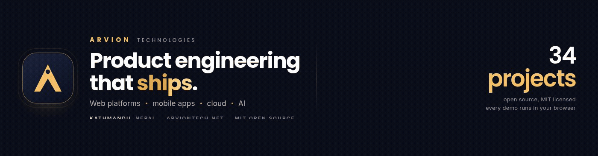
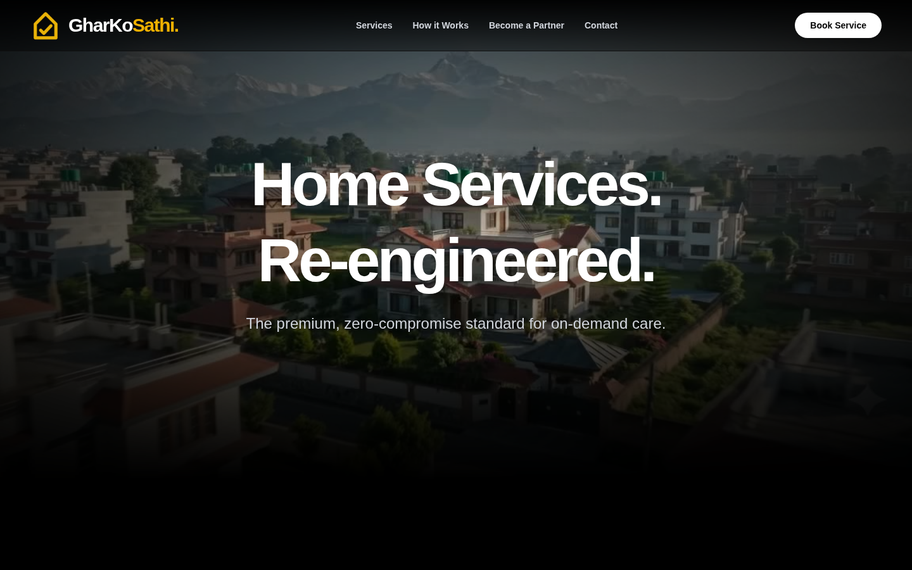
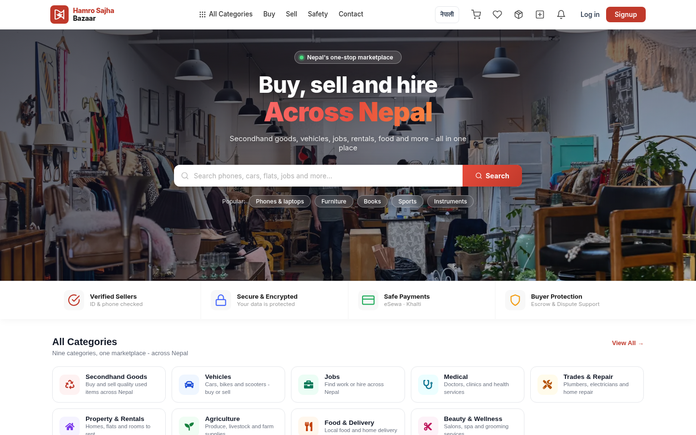
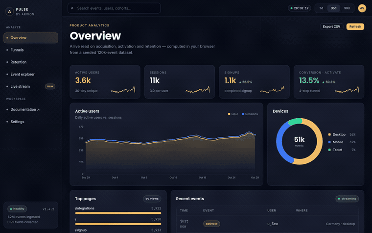
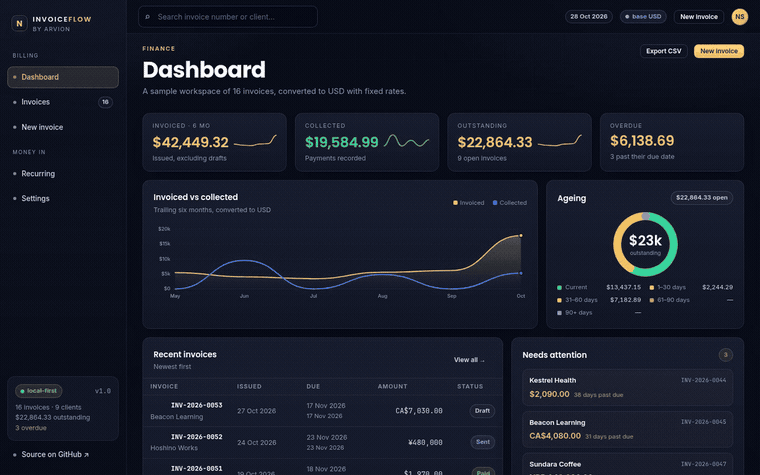
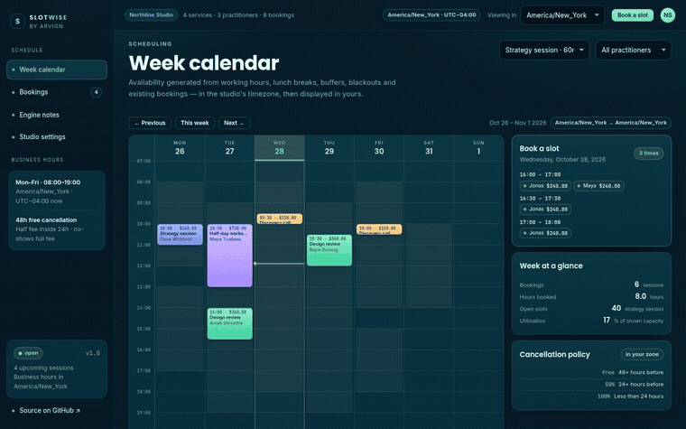
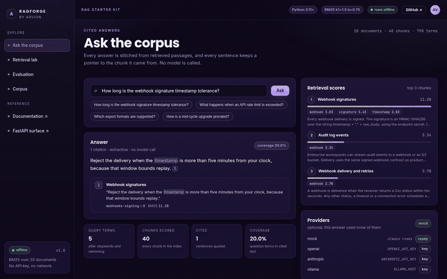

# Arvion Technologies

**Product engineering studio · Kathmandu, Nepal**

We design, build and ship software: web platforms, mobile apps, cloud systems and the
AI features that sit inside them. Small team, senior engineers, no hand-offs between
design, backend and release.

  <b>Company profile:</b> <a href="https://arvion-technology.github.io/labs/assets/arvion-company-profile.pdf">PDF</a> ·
  <a href="https://arvion-technology.github.io/labs/work.html">work and case studies</a> ·
  <a href="https://arvion-technology.github.io/labs/company.html">services</a> ·
  <a href="https://arvion-technology.github.io/labs/brand.html">brand kit</a>

---

## What we build

| | |
| --- | --- |
| **Web platforms** | Product and marketplace front ends, dashboards, admin tools. React, Next.js, Vue, server-rendered where it matters. |
| **Mobile apps** | Flutter and React Native, from the first screen to store release. Offline-first data, payments, push, deep links. |
| **APIs and backend** | NestJS, Node, Python, PostgreSQL, Redis, queues and background jobs. Designed to be operated, not just deployed. |
| **Cloud and delivery** | AWS and GCP, Docker, Kubernetes, CI/CD, observability, cost control, runbooks. |
| **Payments and integrations** | eSewa, Khalti, Stripe, Razorpay, SMS/OTP, KYC providers, ERP and CRM integrations. |
| **AI features** | Retrieval over your own documents, document extraction, drafting and evaluation harnesses: with an honest fallback when the model is unavailable. |

## Products we run

<table>
<tr>
<td width="50%"></td>
<td width="50%"></td>
</tr>
<tr>
<td><b><a href="https://gharkosewa.com">GharKo Sathi</a></b>, on-demand home services in Nepal. KYC-verified professionals, escrow payments, dispute resolution, separate customer and partner apps. Flutter clients, React web, NestJS API, eSewa/Khalti payouts.</td>
<td><b><a href="https://hamrosajhabazaar.com">Hamro Sajha Bazaar</a></b>, national multi-category marketplace: secondhand goods, vehicles, jobs, rentals, medical, trades, food. Seller verification, escrow, buyer protection, Nepali/English UI.</td>
</tr>
</table>

## Case studies

Written up with the problem, the build, the architecture and the decisions behind it.

**In production**

| Work | What it covers | Case study |
| --- | --- | --- |
| GharKo Sathi: home services | KYC-verified professionals, escrow payments, dispute resolution, customer and partner apps, operations console | [read](https://arvion-technology.github.io/labs/case-gharkosathi.html) |
| Hamro Sajha Bazaar: marketplace | Nine categories, seller verification, escrow and buyer protection, bilingual UI, eSewa/Khalti checkout | [read](https://arvion-technology.github.io/labs/case-bazaar.html) |
| Mero Bazaar: production codebase | Public marketplace platform: 43 controllers, 70 backend spec files, 58 migrations, 112 front-end pages | [read](https://arvion-technology.github.io/labs/case-merobazaar.html) |

**Product samples**

| Sample | What it covers | Case study |
| --- | --- | --- |
| Pulse: analytics | Ordered funnels, weekly retention cohorts, live events over a seeded 120k-event dataset | [read](https://arvion-technology.github.io/labs/case-pulse.html) |
| Bazaar Store: commerce | Cart pricing and promos, stock reservation, payment adapters, order state machine | [read](https://arvion-technology.github.io/labs/case-storefront.html) |
| Relay: AI support | Cited answers, tool calls, confidence threshold, human hand-off, evaluation harness | [read](https://arvion-technology.github.io/labs/case-relay.html) |
| Notewise: documents | Block tree, slash commands, nesting, coalesced undo, Markdown round-trip | [read](https://arvion-technology.github.io/labs/case-notewise.html) |

[All work and case studies →](https://arvion-technology.github.io/labs/work.html)

## Open-source labs

Thirty-four runnable projects, each with tests, a live demo and an honest README. They are how we
work when nobody is watching. Every demo is static and runs in your browser, no
sign-up, no API key. Full gallery: **[arvion-technology.github.io/labs](https://arvion-technology.github.io/labs/)**

### Demos in motion

<table>
<tr>
<td width="50%"> <b>Pulse</b>, product analytics: funnels, cohorts, live events</td>
<td width="50%"> <b>InvoiceFlow</b>, invoicing with integer money math and tax rules</td>
</tr>
<tr>
<td width="50%"> <b>Slotwise</b>, timezone-correct booking and scheduling</td>
<td width="50%"> <b>RAGForge</b>, retrieval with citations and an eval harness</td>
</tr>
</table>

### Product and SaaS

- **[Pulse](https://github.com/arvion-technology/pulse)**: product analytics with funnels, retention cohorts and a live event stream · [demo](https://arvion-technology.github.io/labs/demos/pulse/demo/)
- **[InvoiceFlow](https://github.com/arvion-technology/invoiceflow)**: invoicing and billing with integer money math, tax rules and recurring schedules · [demo](https://arvion-technology.github.io/labs/demos/invoiceflow/demo/)
- **[Deskly](https://github.com/arvion-technology/deskly)**: helpdesk with business-hours SLA timers, macros and CSAT · [demo](https://arvion-technology.github.io/labs/demos/deskly/demo/)
- **[Slotwise](https://github.com/arvion-technology/slotwise)**: booking engine with DST-correct availability and ICS export · [demo](https://arvion-technology.github.io/labs/demos/slotwise/demo/)
- **[Leadpipe](https://github.com/arvion-technology/leadpipe)**: CRM with weighted forecast and stage-age tracking · [demo](https://arvion-technology.github.io/labs/demos/leadpipe/demo/)
- **[PeopleOps](https://github.com/arvion-technology/peopleops)**: onboarding checklists, leave accrual and approvals · [demo](https://arvion-technology.github.io/labs/demos/peopleops/demo/)
- **[EventPass](https://github.com/arvion-technology/eventpass)**: ticketing with a QR encoder written from scratch · [demo](https://arvion-technology.github.io/labs/demos/eventpass/demo/)
- **[SchoolKit](https://github.com/arvion-technology/schoolkit)**: attendance, fee ledger, exams and report cards · [demo](https://arvion-technology.github.io/labs/demos/schoolkit/demo/)

### Productivity and collaboration

- **[Notewise](https://github.com/arvion-technology/notewise)**: block editor with slash commands, nesting and Markdown round-trip · [demo](https://arvion-technology.github.io/labs/demos/notewise/demo/)
- **[Canvas](https://github.com/arvion-technology/whiteboard)**: infinite whiteboard with connectors, live cursors and PNG/SVG export · [demo](https://arvion-technology.github.io/labs/demos/whiteboard/demo/)

### Commerce

- **[Bazaar Store](https://github.com/arvion-technology/storefront)**: storefront and back office: catalogue, cart, promo codes, checkout, order states · [demo](https://arvion-technology.github.io/labs/demos/storefront/demo/)

### AI and data

- **[Relay](https://github.com/arvion-technology/relay)**: AI support agent with cited answers, tool calls and human hand-off · [demo](https://arvion-technology.github.io/labs/demos/relay/demo/)
- **[RAGForge](https://github.com/arvion-technology/ragforge)**: retrieval-augmented generation starter kit with BM25 retrieval and an eval harness that runs without an API key · [demo](https://arvion-technology.github.io/labs/demos/ragforge/demo/)
- **[DocMind](https://github.com/arvion-technology/docmind)**: invoice and receipt extraction with confidence scoring and a review queue · [demo](https://arvion-technology.github.io/labs/demos/docmind/demo/)
- **[LeadScout](https://github.com/arvion-technology/leadscout)**: researched outreach: crawl signals, explainable ICP score, cited drafts · [demo](https://arvion-technology.github.io/labs/demos/leadscout/demo/)
- **[PromptOps](https://github.com/arvion-technology/promptops)**: prompt registry, assertion suites and regression diffs · [demo](https://arvion-technology.github.io/labs/demos/promptops/demo/)
- **[ForecastLab](https://github.com/arvion-technology/forecastlab)**: Holt-Winters forecasting with walk-forward backtesting · [demo](https://arvion-technology.github.io/labs/demos/forecastlab/demo/)

### Developer tools

- **[MockForge](https://github.com/arvion-technology/mockforge)**: stateful mock API server generated from an OpenAPI spec · [demo](https://arvion-technology.github.io/labs/demos/mockforge/demo/)
- **[TypeForge](https://github.com/arvion-technology/typeforge)**: JSON Schema to TypeScript, Zod, Python and Go models · [demo](https://arvion-technology.github.io/labs/demos/typeforge/demo/)
- **[FlagKit](https://github.com/arvion-technology/flagkit)**: feature flags with deterministic bucketing and targeting rules · [demo](https://arvion-technology.github.io/labs/demos/flagkit/demo/)
- **[EnvSafe](https://github.com/arvion-technology/envsafe)**: typed, validated environment configuration that fails at boot · [demo](https://arvion-technology.github.io/labs/demos/envsafe/demo/)
- **[SearchLite](https://github.com/arvion-technology/searchlite)**: full-text search with BM25, stemming, fuzzy queries and facets · [demo](https://arvion-technology.github.io/labs/demos/searchlite/demo/)

### Backend and realtime

- **[QueueKit](https://github.com/arvion-technology/queuekit)**: durable background jobs with backoff, concurrency limits and a dead-letter queue · [demo](https://arvion-technology.github.io/labs/demos/queuekit/demo/)
- **[SocketChat](https://github.com/arvion-technology/socketchat)**: WebSocket chat server on node:http with no dependencies · [demo](https://arvion-technology.github.io/labs/demos/socketchat/demo/)

### Cloud and DevOps

- **[Compose Cookbook](https://github.com/arvion-technology/compose-cookbook)**: twelve Docker Compose stacks with healthchecks and backup scripts · [demo](https://arvion-technology.github.io/labs/demos/compose-cookbook/demo/)
- **[K8s Blueprint](https://github.com/arvion-technology/k8s-blueprint)**: Helm chart and Kustomize overlays for a 12-factor app · [demo](https://arvion-technology.github.io/labs/demos/k8s-blueprint/demo/)
- **[AWS Baseline](https://github.com/arvion-technology/aws-baseline)**: Terraform modules for a secure, observable AWS account · [demo](https://arvion-technology.github.io/labs/demos/aws-baseline/demo/)
- **[CI Templates](https://github.com/arvion-technology/ci-templates)**: reusable GitHub Actions workflows with least-privilege permissions · [demo](https://arvion-technology.github.io/labs/demos/ci-templates/demo/)

### Design and frontend

- **[Arvion UI](https://github.com/arvion-technology/design-system)**: design system: tokens, 30 components, contrast-checked themes · [demo](https://arvion-technology.github.io/labs/demos/design-system/demo/)
- **[Motion Lab](https://github.com/arvion-technology/motion-lab)**: CSS animation recipes with reduced-motion fallbacks · [demo](https://arvion-technology.github.io/labs/demos/motion-lab/demo/)
- **[Landing Kit](https://github.com/arvion-technology/landing-kit)**: six conversion-focused landing page templates · [demo](https://arvion-technology.github.io/labs/demos/landing-kit/demo/)

### Mobile

- **[GharKo Sathi app](https://github.com/arvion-technology/gharkosathi-app)**: Flutter architecture case study from a production home-services app · [case study](https://arvion-technology.github.io/labs/demos/gharkosathi-app/demo/)
- **[Bazaar app](https://github.com/arvion-technology/bazaar-app)**: React Native marketplace case study with local payment rails · [case study](https://arvion-technology.github.io/labs/demos/bazaar-app/demo/)
- **[SyncKit](https://github.com/arvion-technology/sync-kit)**: offline-first sync with vector clocks and a two-client simulation · [demo](https://arvion-technology.github.io/labs/demos/sync-kit/demo/)

## How we work

We keep a dated [build log](https://arvion-technology.github.io/labs/build-log.html) and
[engineering notes](https://github.com/arvion-technology/engineering-notes) next to the
code, the decisions, the gotchas, and what we chose not to do.

- **Tests before screenshots.** Every repository runs its own suite in CI on two
  versions of the runtime. If it is not tested, it does not go on the internet.
- **Honest documentation.** Each README says what the code does, how the hard part
  works, and what it deliberately does not do. No invented benchmarks.
- **MIT licensed.** Use the code, fork it, take the parts that help. That is the point
  of publishing it.
- **Small, senior team.** The person who designs the system writes the migration and
  answers the page at 2am.

## Start something

If you need a product built end to end, web, mobile, cloud, payments, AI, we are a
good fit for teams that want senior engineering without a large agency layer.

**Website:** [arviontech.net](https://arviontech.net) · **Email:** [hello@arviontech.net](mailto:hello@arviontech.net)

Arvion Technologies Pvt. Ltd. · Ward No. 32, Tinkune, Kathmandu, Nepal · PAN 6236009191
